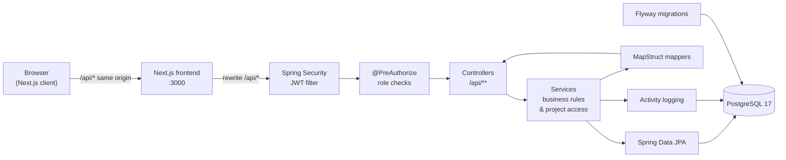
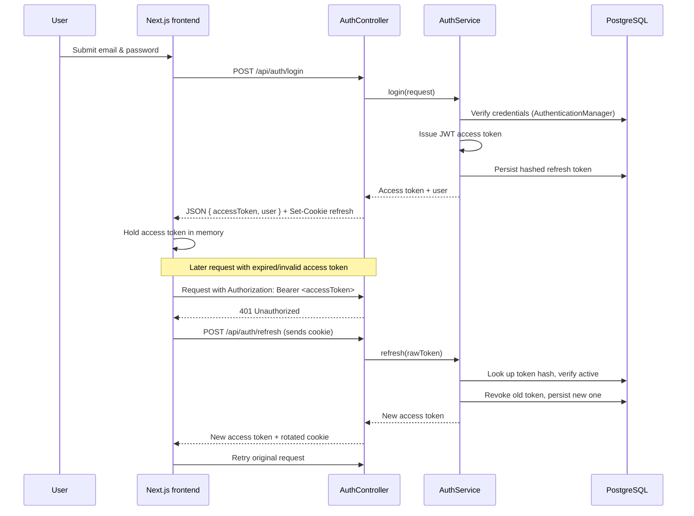
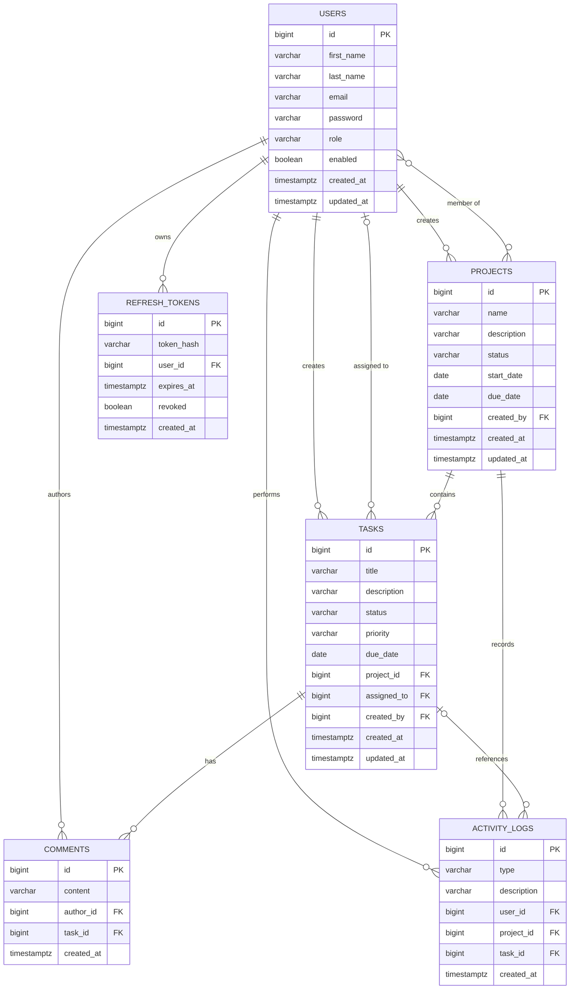

<p align="center">
  
</p>

<h1 align="center">TaskFlow</h1>

<p align="center">
  <strong>Collaborative Project &amp; Task Management Platform</strong>
</p>

<p align="center">
  TaskFlow is a full-stack project management application that helps teams organise projects,
  assign tasks, track progress across a Kanban board, and stay in sync through comments and an
  activity feed. It pairs a Spring Boot REST API with a modern Next.js front end and is designed
  around role-based access control.
</p>

<p align="center">
  <a href="https://www.java.com/"></a>
  <a href="https://spring.io/projects/spring-boot"></a>
  <a href="https://nextjs.org/"></a>
  <a href="https://www.typescriptlang.org/"></a>
  <a href="https://www.postgresql.org/"></a>
  <a href="https://www.docker.com/"></a>
</p>

<p align="center">
  <a href="#overview">Overview</a> ·
  <a href="#features">Features</a> ·
  <a href="#roles--permissions">Roles</a> ·
  <a href="#architecture">Architecture</a> ·
  <a href="#tech-stack">Tech Stack</a> ·
  <a href="#getting-started">Getting Started</a> ·
  <a href="#testing">Testing</a> ·
  <a href="#security">Security</a>
</p>

---

## Product Preview

<!--
  Add screenshots or an animated demo here once they are captured, for example:

  <p align="center">
    
  </p>

  <p align="center">
    
  </p>

  Suggested captures: login, dashboard summary, project list, project detail,
  Kanban task board, and the activity feed.
-->

## Overview

TaskFlow gives a team a single place to plan and execute work:

- **Projects** group related work, carry a lifecycle status, and have an explicit member list.
- **Tasks** belong to a project and move through a four-stage workflow (`TODO`, `IN_PROGRESS`, `IN_REVIEW`, `DONE`) with priority and due dates.
- **Comments** let team members discuss individual tasks.
- **Activity logs** record the important events inside a project (project changes, membership changes, task creation, assignment, status changes, and comments).
- **A dashboard** summarises the work that matters to the signed-in user.

Access is role-based. Every user has one of three roles, and each project also has a member list,
so most operations are additionally scoped to the project a user belongs to.

| Role | Intended use |
| --- | --- |
| **ADMIN** | Full access across the whole system, including user management. |
| **MANAGER** | Works within projects they belong to and can manage project content. |
| **MEMBER** | Regular contributor: creates and works on tasks they are involved with. |

## Features

| Area | Capability |
| --- | --- |
| Authentication | Register, log in, log out, and refresh sessions with a JWT access token plus a rotating httpOnly refresh cookie. |
| Users | Profile endpoint (`/api/auth/me`), a directory of users, and an admin-only listing for user management. |
| Projects | Create, view, update, and delete projects; each project tracks status, start/due dates, owner, and members. |
| Project membership | Add and remove members; membership drives all project and task authorisation. |
| Tasks | Create tasks inside a project, edit them, delete them, assign/unassign to project members, and move them through the workflow. |
| Task filtering | Filter a project's tasks by status, priority, and assignee, with text search and pagination. |
| "My tasks" | A cross-project view of tasks assigned to the current user, filterable by status. |
| Comments | Threaded-by-task comment listing for any project member, with edit and delete rules. |
| Activity feed | A per-project log of meaningful events, published as the project is used. |
| Dashboard | An overview of a user's projects and task counts, broken down by status. |
| Front end | A responsive Next.js app with authentication flows, dashboard, project views, a Kanban board, and profile/admin pages. |
| Database migrations | Schema is versioned with Flyway; Hibernate runs in `validate` mode against the migrated schema. |

## Roles & Permissions

The rules below reflect the authorisation enforced in the API
(`ProjectAccessService`, `TaskService`, `CommentService`, and `@PreAuthorize` on controllers).

- **Global role** is one of `ADMIN`, `MANAGER`, `MEMBER`.
- **Project scope** matters too: a user may be the project **owner** (`createdBy`), a **member**, both, or neither.
- "Manage a project" means an `ADMIN`, the project owner, or a `MANAGER` who is a member of that project.

| Capability | ADMIN | MANAGER | MEMBER |
| --- | :---: | :---: | :---: |
| List & manage all users | Yes | – | – |
| Create a project | Yes | Yes | – |
| View a project | Yes | Yes¹ | Yes¹ |
| Update a project | Yes | Yes¹ | – |
| Delete a project | Yes | Owner² | – |
| Manage project members | Yes | Yes¹ | – |
| Create a task in a project | Yes | Yes¹ | Yes¹ |
| Edit / delete a task | Yes | Yes³ | Creator³ |
| Assign or unassign a task | Yes | Yes¹ | – |
| Change a task's status | Yes | Yes³ | Assignee or creator³ |
| Comment on a task | Yes | Yes¹ | Yes¹ |
| Edit a comment | Author or ADMIN | Author | Author |
| Delete a comment | Author, ADMIN, or manager | Author or manager | Author |

<sub>
¹ Requires being a member of the project (an `ADMIN` bypasses the membership check).<br/>
² `ADMIN`, or the project owner (`createdBy`). A manager who is not the owner cannot delete.<br/>
³ Any project manager, the task creator, or — for status changes only — the assignee.
</sub>

## Architecture

TaskFlow is a monorepo with a Spring Boot backend, a Next.js frontend, and a PostgreSQL database
managed through Docker Compose. The frontend proxies same-origin `/api/*` requests to the backend
so the browser never makes a cross-origin call in the default setup.



The backend layers are deliberately thin: **controllers** handle HTTP and validation, **services**
hold business rules and authorisation, **repositories** (with JPA Specifications) handle queries, and
**MapStruct mappers** translate entities into DTOs so entities are never exposed directly.

## Authentication Flow

Authentication uses a short-lived **JWT access token** returned in the response body, plus a
**refresh token** stored in an httpOnly cookie scoped to `/api/auth`. Refresh tokens are rotated on
every use and only their SHA-256 hash is persisted.



On logout the refresh token is revoked server-side and the cookie is cleared.

## Tech Stack

| Layer | Technology |
| --- | --- |
| Language | Java 21 |
| Backend framework | Spring Boot 4.1 (Spring MVC, Spring Data JPA, Spring Security, Validation) |
| Auth | JWT (Nimbus JOSE + JWT), BCrypt password hashing, rotating refresh tokens |
| Persistence | PostgreSQL, Hibernate/JPA, Flyway migrations, JPA Specifications for filtering |
| Mapping | MapStruct |
| Build (backend) | Maven (via the bundled `mvnw` / `mvnw.cmd` wrapper) |
| Backend tooling | Lombok, Spring Boot Actuator (`health`, `info`) |
| Frontend | Next.js 16 (App Router), React 19, TypeScript |
| Styling | Tailwind CSS v4 |
| Linting (frontend) | ESLint (`eslint-config-next`) |
| Database (local) | PostgreSQL 17 via Docker Compose |
| Backend tests | JUnit 5, Mockito, MockMvc, Testcontainers (PostgreSQL) |

## Domain Model

| Entity | Key fields | Relationships |
| --- | --- | --- |
| `User` | id, firstName, lastName, email (unique), password (hashed), role, enabled, createdAt, updatedAt | Referenced as project owner, member, task creator/assignee, comment author, activity actor |
| `Project` | id, name, description, status, startDate, dueDate, createdAt, updatedAt | `createdBy` → User; `members` ↔ User (many-to-many via `project_members`); has many tasks and activities |
| `ProjectMember` | join of Project ↔ User (`project_members`) | Membership drives project & task authorisation |
| `Task` | id, title, description, status, priority, dueDate, createdAt, updatedAt | `project` → Project; `assignedTo` → User (nullable); `createdBy` → User; has many comments and activity entries |
| `Comment` | id, content, createdAt | `author` → User; `task` → Task |
| `ActivityLog` | id, type, description, createdAt | `user` → User; `project` → Project; optional `task` → Task |
| `RefreshToken` | id, tokenHash (unique), expiresAt, revoked, createdAt | `user` → User |

Enumerations:

- `Role`: `ADMIN`, `MANAGER`, `MEMBER`
- `ProjectStatus`: `PLANNING`, `ACTIVE`, `COMPLETED`, `ARCHIVED`
- `TaskStatus`: `TODO`, `IN_PROGRESS`, `IN_REVIEW`, `DONE`
- `TaskPriority`: `LOW`, `MEDIUM`, `HIGH`, `URGENT`
- `ActivityType`: `PROJECT_CREATED`, `PROJECT_UPDATED`, `MEMBER_ADDED`, `MEMBER_REMOVED`, `TASK_CREATED`, `TASK_ASSIGNED`, `TASK_STATUS_CHANGED`, `COMMENT_ADDED`



## Project Structure

```
taskflow/
├── backend/                 Spring Boot API
│   ├── src/main/java/com/taskflow/
│   │   ├── config/          Security, JWT/CORS/seed properties, data seeding
│   │   ├── controller/      REST controllers under /api/**
│   │   ├── dto/             Request and response records (request/, response/)
│   │   ├── entity/          JPA entities and enums
│   │   ├── exception/       Domain exceptions and global error handling
│   │   ├── mapper/          MapStruct entity ↔ DTO mappers
│   │   ├── repository/      Spring Data repositories (+ specification/)
│   │   ├── security/        JWT service, principal, auth filters/handlers
│   │   └── service/         Business logic and authorisation
│   ├── src/main/resources/
│   │   ├── application.yml
│   │   └── db/migration/    Flyway migrations (V1__init.sql, ...)
│   ├── src/test/java/...    Unit and integration tests
│   ├── .env.example         Backend environment variable template
│   ├── mvnw / mvnw.cmd      Maven wrapper
│   └── pom.xml
├── frontend/                Next.js application
│   ├── public/              Static assets (incl. image/logo.png)
│   ├── src/
│   │   ├── app/             App Router routes ((auth)/, (app)/, api proxy usage)
│   │   ├── components/      UI components (layout, ui, feature components)
│   │   └── lib/             API client, auth context, types, helpers
│   ├── next.config.ts       Same-origin /api proxy to the backend
│   ├── package.json
│   └── tsconfig.json
├── docker-compose.yml       Local PostgreSQL 17
└── README.md
```

## Getting Started

### Prerequisites

- **Java 21** (JDK)
- **Node.js** and **npm**
- **Docker** (for the local PostgreSQL container and for backend tests via Testcontainers)

The backend ships with a Maven wrapper, so a separate Maven installation is not required.

### 1. Start the database

```bash
docker compose up -d db
```

This starts PostgreSQL 17 on host port **15432** (chosen to avoid clashing with a local PostgreSQL
on the default 5432) with database, user, and password all defaulting to `taskflow`.

### 2. Run the backend

```bash
cd backend
./mvnw spring-boot:run          # Windows: .\mvnw.cmd spring-boot:run
```

The API starts on **http://localhost:8080**. Flyway applies the schema on startup and, with seeding
enabled, development accounts are created (see below). Health check: **http://localhost:8080/actuator/health**.

To customise configuration, copy `backend/.env.example` to `backend/.env` and edit it — the backend
loads `backend/.env` automatically, and real environment variables always take precedence.

### 3. Run the frontend

```bash
cd frontend
npm install
npm run dev
```

The app is served at **http://localhost:3000**. It proxies same-origin `/api/*` requests to the
backend at `http://localhost:8080`, so no CORS configuration is needed in the default setup.

### 4. Sign in

Open **http://localhost:3000**, register a new account, or use one of the development accounts below.

## Environment Variables

### Backend (`backend/.env.example`)

| Variable | Default | Description |
| --- | --- | --- |
| `DB_URL` | `jdbc:postgresql://localhost:15432/taskflow` | JDBC URL of the database. |
| `DB_USERNAME` | `taskflow` | Database user. |
| `DB_PASSWORD` | `taskflow` | Database password. |
| `JWT_SECRET` | `change-me-dev-only-secret-change-me-dev-only-secret` | HMAC secret for signing access tokens. Must be at least 32 bytes; use a long random value (`openssl rand -base64 48`) outside local development. |
| `JWT_ACCESS_TTL_SECONDS` | `900` | Access token lifetime (15 minutes). |
| `JWT_REFRESH_TTL_SECONDS` | `604800` | Refresh token lifetime (7 days). |
| `CORS_ALLOWED_ORIGINS` | `http://localhost:3000` | Allowed browser origins when the API is called cross-origin. |
| `COOKIE_SECURE` | `false` | Set to `true` in production (HTTPS) so the refresh cookie is TLS-only. |
| `SEED_DATA_ENABLED` | `true` | Creates the development accounts on startup. |
| `SEED_ADMIN_EMAIL` / `SEED_ADMIN_PASSWORD` | `admin@taskflow.local` / `Admin123!` | Seeded admin account. |
| `SEED_MANAGER_EMAIL` / `SEED_MANAGER_PASSWORD` | `manager@taskflow.local` / `Manager123!` | Seeded manager account. |
| `SEED_MEMBER_EMAIL` / `SEED_MEMBER_PASSWORD` | `member@taskflow.local` / `Member123!` | Seeded member account. |

### Frontend

| Variable | Default | Description |
| --- | --- | --- |
| `NEXT_PUBLIC_API_BASE_URL` | `/api` | Base URL the browser client calls for the API. |
| `BACKEND_URL` | `http://localhost:8080` | Server-side target for the Next.js rewrite that proxies `/api/*`. |

## Development Accounts

> [!WARNING]
> The accounts below are **seeded for local development only**. They are created only when
> `SEED_DATA_ENABLED` is `true` (the default) and use intentionally weak, publicly known passwords.
> Disable seeding (`SEED_DATA_ENABLED=false`) and set a strong `JWT_SECRET` before running TaskFlow
> anywhere that is not a local machine.

| Role | Email | Password |
| --- | --- | --- |
| Admin | `admin@taskflow.local` | `Admin123!` |
| Manager | `manager@taskflow.local` | `Manager123!` |
| Member | `member@taskflow.local` | `Member123!` |

## Testing

Backend tests use JUnit 5, Mockito, MockMvc, and Testcontainers (a real PostgreSQL container), so
**Docker must be running** for the integration tests.

```bash
cd backend
./mvnw test          # Windows: .\mvnw.cmd test
```

The suite covers service-level logic with Mockito, an authentication controller slice test, and
integration tests backed by Testcontainers.

The frontend currently has ESLint and a production build as its quality gates:

```bash
cd frontend
npm run lint
npm run build
```

## Engineering Decisions

| Decision | Rationale |
| --- | --- |
| Access token in memory, refresh token in an httpOnly cookie | Keeps the long-lived credential out of JavaScript's reach while allowing short access-token lifetimes. |
| Refresh token rotation with hashed storage | A refresh token can only be used once, and a database leak exposes only SHA-256 hashes, not usable tokens. |
| Authorisation in services, not just controllers | Project-scoped rules (owner/member/role) are centralised in `ProjectAccessService` so every entry point enforces them. |
| Layered structure with MapStruct DTOs | Entities never leave the service layer; request/response shapes are explicit and mapping is generated. |
| Flyway migrations with Hibernate `validate` | The schema is versioned and reproducible; Hibernate fails fast on drift instead of mutating the database. |
| Same-origin API proxy from Next.js | The browser always talks to its own origin (`/api`), avoiding CORS complexity and cookie cross-site issues in development. |
| JPA Specifications for task filtering | Status, priority, assignee, and text filters compose cleanly into a single type-safe query. |
| Config via environment variables with dev defaults | The app runs with zero configuration locally while every secret and endpoint is overridable per environment. |

## Security

Implemented in this codebase:

- Password hashing with **BCrypt**.
- Stateless **JWT** authentication (signed with a configurable HMAC secret of at least 32 bytes), with no server session.
- **Rotating refresh tokens** stored only as SHA-256 hashes, delivered in an **httpOnly** cookie scoped to `/api/auth` (and configurable as TLS-only via `COOKIE_SECURE`).
- **Role-based access control** at the controller (`@PreAuthorize`) and service layers, plus per-project ownership/membership checks.
- **CSRF protection disabled only because the API is stateless** and the refresh cookie is scoped to a single POST endpoint; CORS is restricted to configured origins.
- Validation on incoming requests and centralised exception handling with consistent JSON error responses.
- All secrets are supplied through environment variables, and only an `.env.example` template is committed.

Before deploying anywhere real: set a strong `JWT_SECRET`, set `COOKIE_SECURE=true`, restrict
`CORS_ALLOWED_ORIGINS` to your front end, and set `SEED_DATA_ENABLED=false`.

## Future Improvements

These are not implemented today — they are ideas for extending the project:

- Team/workspace model for grouping projects beyond membership.
- Real-time updates for activity feeds and task boards (WebSockets/SSE).
- Notifications (email or in-app) for assignments and due-date reminders.
- File attachments on tasks and comments.
- Drag-and-drop Kanban ordering with persisted task position.
- Full-text search across projects and tasks.
- Automated CI (build, lint, and test on every push) and containerised deployment.
- Expanded frontend test coverage (component and end-to-end tests).

## Author

<p align="center">
  <strong>Zayd Kassimi</strong><br/>
  Portfolio: <a href="https://zaydkassimi.me/">zaydkassimi.me</a> ·
  LinkedIn: <a href="https://www.linkedin.com/in/zayd-kassimi/">zayd-kassimi</a> ·
  GitHub: <a href="https://github.com/zaydkassimi">zaydkassimi</a>
</p>
